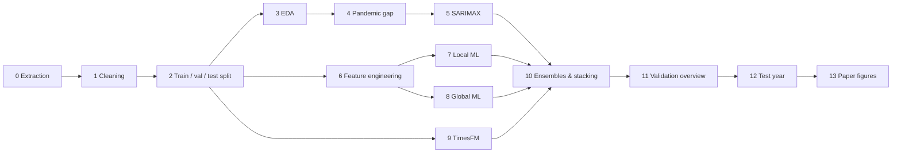

# Regime Change Undermines Model Selection for Brazilian International Tourism Forecasting

**MBA Thesis — Data Science & Analytics | USP ESALQ, 2026**
**Author:** Gabriel Moraes Magalhães | **Advisor:** Édipo Menezes Da Silva

> This README is an English, Markdown version of the final paper
> ([*Mudança de regime compromete a seleção de modelos de previsão do turismo internacional brasileiro*](documents/paper_development/Trabalho%20Final%20-%20Gabriel%20Moraes%20Magalh%C3%A3es.pdf), in Portuguese),
> with every step linked to the notebook that produced it and to the tools used along the way.

---

## Contents

- [Abstract](#abstract)
- [Key Results at a Glance](#key-results-at-a-glance)
- [Introduction](#introduction)
- [Materials and Methods](#materials-and-methods)
- [Results and Discussion](#results-and-discussion)
- [Conclusion](#conclusion)
- [Reproducing the Study](#reproducing-the-study)
- [Repository Structure](#repository-structure)
- [References](#references)

---

## Abstract

International tourism is relevant to the Brazilian economy, and planning in the sector depends on
demand forecasts. In 2025, foreign tourist arrivals grew far beyond what was expected. This study
compared statistical, machine learning and foundation-model approaches for forecasting monthly
international tourist arrivals to Brazil **12 months ahead**, and checked whether model selection by
validation held after a **regime change**.

The Ministry of Tourism series from January 1989 to August 2026 was used. SARIMAX models, linear and
gradient-boosting regressors trained on the total series and on a panel of disaggregated series, the
TimesFM foundation model without task-specific training, and combinations of these models were
evaluated. Selection used four validation origins and the **seasonal mean absolute scaled error
(MASE)**, and September 2025 – August 2026 was held out as the test year.

On validation, the mean of XGBoost and SARIMAX had the lowest scaled error (0.932), and TimesFM came
last among the models (1.312). On the test year, arrivals grew 4.1% after a 39.6% jump the year
before; **TimesFM was the only model to beat the seasonal naive** (0.767 vs 1.191), and the trained
models over-forecast the year by 27% to 50%. The rank correlation between the validation and test
rankings was **−0.48**. Selection by validation rewarded extrapolating recent growth and lost its
validity when the regime changed.

**Keywords:** time series; seasonal MASE; XGBoost; TimesFM; temporal validation.

## Key Results at a Glance

| Approach | Validation MASE (mean of 4 origins) | Test MASE | Test MAPE | Test bias |
|---|---:|---:|---:|---:|
| Mean: local XGBoost + SARIMAX *(selected on validation)* | **0.932** | 5.410 | 38.6% | −40.1% |
| Local XGBoost | 0.982 | 6.744 | 48.0% | −50.0% |
| SARIMAX | 0.992 | 4.075 | 29.3% | −30.2% |
| Global XGBoost | 1.101 | 3.623 | 26.1% | −26.9% |
| TimesFM 3.0 (zero-shot) | 1.312 | **0.767** | **6.9%** | −1.8% |
| Seasonal naive | 1.786 | 1.191 | 9.1% | 3.9% |

The validation ranking inverted on the test year (Spearman ρ = −0.48). The full tables are in
[Results and Discussion](#results-and-discussion).

---

## Introduction

Tourism holds a prominent position in the Brazilian economy. According to the World Travel & Tourism
Council (WTTC), Brazil was the 7th country generating the most jobs in the sector, with 8.21 million
jobs forecast for 2025, and 12th in tourism's contribution to GDP, estimated at US$ 167.6 billion
(MTUR, 2025). Infrastructure, international promotion and public-policy goals depend on estimates of
future demand, and errors in these estimates lead to both idle capacity and saturated destinations.

The year 2025 illustrated how hard this task is. Brazil received **9,287,196 foreign tourists, 37.1%
more than in 2024**, beating by 34.6% the goal of 6.9 million arrivals set in the *Plano Nacional de
Turismo* (PNT) 2024–2027 (Agência Brasil, 2026). This jump came only a few years after the collapse
caused by the COVID-19 pandemic: in six years the series went through an abrupt fall, a recovery and
an unprecedented acceleration, which challenges methods based on extrapolating the past.

In the tourism demand forecasting literature, the competition run by Athanasopoulos et al. (2011)
showed that pure time series approaches were more accurate than models with explanatory variables,
and adopted MASE to compare series of different scales. Since then, the toolbox has grown with machine
learning models built on lagged features (Joseph & Tackes, 2024) and with foundation models
pretrained on large collections of real and synthetic series, able to forecast new series without
specific training (Das et al., 2024).

Whatever the model family, the final configuration is usually chosen by its performance on validation
windows before the period of use. On non-stationary series this choice is only reliable if the
validation windows represent the period being forecast (Joseph & Tackes, 2024). When the regime changes
between validation and use, the configuration that best followed the recent past may be exactly the one
that errs the most, a risk rarely measured in comparative studies that report a single test period.

**Objective.** Compare SARIMAX models, local and global machine learning models, the TimesFM foundation
model and combinations of these models for forecasting monthly international tourist arrivals to Brazil
12 months ahead, and evaluate whether the ranking obtained by multi-origin validation held in a test
year after the 2025 regime change.

---

## Materials and Methods

This is an applied, quantitative, experimental study based on public secondary data. Processing was
done in **Python** with **Jupyter notebooks** run locally, and **every experiment was logged to
[MLflow](https://mlflow.org/)**. The statistical test, target transformation and feature engineering
functions were adapted from the companion repository of Joseph & Tackes (2024),
[*Modern Time Series Forecasting with Python*, 2E](https://github.com/PacktPublishing/Modern-Time-Series-Forecasting-with-Python-2E).

### Pipeline overview



### Data and preparation

| | |
|---|---|
| **Source** | [Estimativas de Chegadas de Turistas Internacionais ao Brasil](https://dados.gov.br/dados/conjuntos-dados/estimativas-de-chegadas-de-turistas-internacionais-ao-brasil) — Ministério do Turismo (MTUR, 2026) |
| **Files** | 38 CSV files with monthly arrival estimates by access route, state of entry and country of residence |
| **Period** | January 1989 – August 2026 (995,126 records after unification) |
| **Target** | Total monthly arrivals, aggregated over routes, origins and destinations: 452 observations |

- **Extraction** — [`0_data_extraction.ipynb`](notebooks/0_data_extraction.ipynb). Column names changed
  over the years, so the files are unified through a name mapping that **stops on unknown columns**.
  Each year is read from a single file, to avoid double-counting the cumulative files of the current
  year.
- **Cleaning** — [`1_data_cleaning.ipynb`](notebooks/1_data_cleaning.ipynb). Records without an
  arrival value (0.99%) were removed. Old files had corrupted characters and different spellings of
  the same category; standardization uses an **accent-insensitive key that fails loudly** on unmapped
  values (`map_strict`), so no new category is dropped silently. The destination region was derived
  from the state, and the 209 origin countries were grouped into eight cultural subdivisions: LATAM,
  Western and Eastern Europe, Anglo-America, APAC, Nordic and Baltic countries, Sub-Saharan Africa,
  MENA and Others.

### Temporal split

[`2_train_test_split.ipynb`](notebooks/2_train_test_split.ipynb) splits the series into three
consecutive blocks:

| Split | Months | Used for |
|---|---|---|
| **Train** | Jan 1989 – Aug 2024 (428 months) | fitting the models |
| **Validation** | Sep 2024 – Aug 2025 | model selection (the latest of the four validation origins) |
| **Test** | Sep 2025 – Aug 2026 | read **once**, in the final evaluation |

The cut dates are **derived from the data**, so adding a new CSV and re-running the notebooks rolls the
three blocks forward. Two checks guard the split: no missing months, and the last published month must
be complete. EDA, feature engineering and all model selection used only train + validation
(paper Figure 1; [`13_final_charts.ipynb`](notebooks/13_final_charts.ipynb), *Figure 1*).

### Exploratory analysis

[`3_exploratory_data_analysis.ipynb`](notebooks/3_exploratory_data_analysis.ipynb) segments the series
into four analytical periods: historical (before 2000), pre-pandemic (Jan 2000 – Mar 2020), pandemic
(Apr 2020 – Dec 2021) and post-pandemic (from Jan 2022). In each period:

- **Trend**: linear and polynomial regression, Kendall's τ, Mann-Kendall (pre-whitened on short
  series) and seasonal Mann-Kendall (m = 12). Deterministic vs stochastic trend by comparing ADF with a
  constant and with constant + trend.
- **Decomposition type**: correlation between the annual mean and standard deviation.
- **Seasonality**: robust STL (period 12, seasonal window 13), seasonal strength
  `1 − Var(residual) / Var(seasonal + residual)`, and an ACF local-maximum test with a Bartlett band.
- **Stationarity**: ADF + KPSS on the level and differenced series. **Heteroscedasticity**: White test.
  **Power transform**: Box-Cox λ estimated with Guerrero's method.

### Handling the pandemic period

[`4_working_with_pandemic_data.ipynb`](notebooks/4_working_with_pandemic_data.ipynb) compares seven
methods to impute the structural break: linear interpolation; STL with PCHIP interpolation of the
trend; cubic spline; forward auto-ARIMA (fitted before the gap); backward auto-ARIMA (fitted on the
reversed series after the gap); a weighted blend of the two ARIMAs; and automatic stationarization
(`AutoStationaryTransformer`) followed by ARIMA.

Thirteen pre-pandemic windows of 6 to 36 months (1995–2015) were masked and reconstructed. Each method
was scored on reconstruction (MAE, RMSE, MAPE, imputed/observed variance ratio) and on a **downstream
metric**: the MAPE of an ARIMA fitted on the imputed series when forecasting the next 12 months, in a
leakage-free geometry. The methods were then applied to the real gap (Apr 2020 – Dec 2021) and compared
on the validation-year forecast.

### Validation protocol and metrics

A single validation window can reward configurations fitted to the quirks of that year (Joseph &
Tackes, 2024). Every configuration was therefore trained and scored at **four non-overlapping
validation origins**, each forecasting the next 12 months: two before the pandemic (Aug 2017, Aug 2018)
and the two most recent (Aug 2023, Aug 2024, the latter being the validation set). At each origin the
model only used the history up to that month, from which the training windows, transformations and
features were rebuilt.

The selection metric was the **seasonal MASE** (eq. 1):

$$
\text{MASE}_s = \frac{\frac{1}{h}\sum_{t=T+1}^{T+h} \lvert y_t - \hat{y}_t \rvert}{\frac{1}{\lvert P \rvert}\sum_{t \in P} \lvert y_t - y_{t-12} \rvert} \tag{1}
$$

where *y* is total arrivals in month *t*, *ŷ* the forecast, *h* = 12 the horizon, *T* the origin, and
*P* the set of history months up to the origin whose pairs (*t*, *t* − 12) do not touch April 2020 –
December 2022.

Scaling by the in-sample seasonal-naive error makes origins with different levels comparable; values
below 1 mean a smaller error than "same month last year". Configurations were ranked by the **mean MASE
over the four origins**, and the **worst origin** was used as a stability indicator. RMSE, MAPE, R² and
**forecast bias**, `(Σy − Σŷ) / Σy × 100` (positive when the year was under-forecast), were also
recorded. The references were the **naive** (last month repeated) and the **seasonal naive** (same month
last year). To compare modelling choices without relying on a single configuration, heatmaps show the
**5% quantile of the mean MASE** of each pair of choices.

### Configuration grids

| Approach | Notebook | Choices crossed in the grid | Configurations | Hyperparameter tuning |
|---|---|---|---:|---|
| SARIMAX | [5](notebooks/5_arima_model_testing.ipynb) | 144 orders × 3 target treatments × 14 training selections | 6,048 | maximum likelihood |
| Local ML | [7](notebooks/7_ml_model_testing.ipynb) | 4 families × 4 target treatments × 8 windows × 2 pandemic treatments × 2 strategies × 6 feature sets | 2,880 | temporal CV (linear); Optuna, 40 trials (trees) |
| Global ML | [8](notebooks/8_global_ml_model_testing.ipynb) | 4 families × 3 target treatments × 3 windows × 2 pandemic treatments × 2 strategies × 3 feature sets | 432 | temporal CV (linear); Optuna, 25 trials (trees) |
| TimesFM | [9](notebooks/9_timesfm_model_testing.ipynb) | 8 context windows × 3 pandemic treatments × 3 target treatments × 4 covariate sets × symmetric averaging | 360 | none (zero-shot) |
| Combinations | [10](notebooks/10_ensembling_and_stacking.ipynb) | 7 methods × 2 member pools | 13 | weights estimated leaving one origin out |

In the ML and TimesFM grids, the post-pandemic window was only combined with keeping the pandemic
months, and TimesFM's pandemic covariates only with keeping those months.

#### SARIMAX — [`5_arima_model_testing.ipynb`](notebooks/5_arima_model_testing.ipynb)

Fitted with **statsmodels**. The grid crossed 144 orders (p, q ∈ {0, 1, 2}; d, D, P, Q ∈ {0, 1};
s = 12); three target treatments: none, natural log, and an automatic stationarization
(`AutoStationaryTransformer`) that removes the linear trend, the seasonality and applies Box-Cox only
when the respective tests call for it; and 14 training selections: windows of the last 4 to 14 years
with a pandemic dummy (Apr 2020 – Dec 2021), with or without a second dummy for the recovery
(Jan – Jun 2022), and windows restricted to the post-pandemic period. Differencing orders were
**searched, not fixed**, to check whether the transformations made differencing unnecessary. AIC and
BIC were logged but not used for ranking, since they are only comparable between models with the same
transformation and differencing. Fits run in parallel with **joblib**.

#### Feature engineering — [`6_feature_engineering.ipynb`](notebooks/6_feature_engineering.ipynb)

For the ML models the series was cast as a supervised regression. Lags were chosen from the
**pre-pandemic PACF** (1, 2, 12, 13, 24 and 36 months) and complemented by 3-, 6- and 12-month rolling
statistics, seasonal rolling means (same month in previous years), EWMAs, month-over-month growth,
Fourier terms of the month, elapsed time, and flags for the pandemic and for lags that point into it.
Every target-derived feature is shifted at least by the forecast step, and a **perturbation test**
(values after a cutoff multiplied by ten without changing any earlier feature) confirmed there is no
leakage. Outputs: `features_recursive.parquet`, `features_direct.parquet` and `feature_groups.json`.

#### Local machine learning — [`7_ml_model_testing.ipynb`](notebooks/7_ml_model_testing.ipynb)

The grid crossed four families (**Ridge, Lasso, LightGBM, XGBoost**); four target treatments (the three
of SARIMAX plus the **seasonal log difference**); eight training windows; two ways of handling the
pandemic (keep the months with their flags, or remove 2020–2022 from the series); two multi-step
strategies (**recursive**, which feeds predictions back, and **direct** with a single model whose
features are known 12 months ahead); and six feature sets. The seasonal log difference and its inverse
are (eq. 2):

$$
z_t = \log y_t - \log y_{t-12}; \qquad \hat{y}_t = y_{t-12} \cdot e^{\hat{z}_t} \tag{2}
$$

where *z* is the annual growth rate on the log scale and *ẑ* its forecast. This lets tree models
forecast levels above the training maximum, a known limitation of trees on trending series (Joseph &
Tackes, 2024).

Ridge and Lasso penalties were chosen by temporal cross-validation (`TimeSeriesSplit`). Trees used a
learning rate of 0.02, up to 2,000 trees and **early stopping on the last 12 months of the training
window**, never on the validation window. The best configuration of each tree family × training window
was refined with **Optuna** (TPE sampler, 40 trials), using the mean MASE over the four origins as the
objective.

#### Global machine learning — [`8_global_ml_model_testing.ipynb`](notebooks/8_global_ml_model_testing.ipynb)

A single model was trained on a **panel of 21 series**: 19 components defined by access route (air and
land), destination region and the three largest origin subdivisions (LATAM, Europe and Anglo-America),
with at least 1,000 monthly arrivals on average; a **remainder** series that completes the sum; and the
**total** series. The components covered 86.2% of training arrivals. Each series has static
identification features and its own fitted target transformation, and the total forecast is the
**bottom-up** sum of the components and the remainder. The best configuration of each tree family ×
window was refined with Optuna (25 trials).

#### TimesFM foundation model — [`9_timesfm_model_testing.ipynb`](notebooks/9_timesfm_model_testing.ipynb)

**TimesFM** (Time Series Foundation Model) is a decoder-only transformer pretrained on a large set of
real and synthetic series, which forecasts a new series without any weight update (Das et al., 2024).
Version **3.0** (`google/timesfm-3.0-pytorch`) was used on the total series. With no weights to fit, the
grid varied the context given to the model: the history window; the pandemic treatment (keep, remove,
or **mask as missing**); the target transformation; calendar and pandemic covariates
(past-and-future covariates); and **symmetric averaging**, which also forecasts the sign-flipped series.
Quantiles 0.1 and 0.9 were used to evaluate the coverage of the 80% interval.

#### Forecast combinations — [`10_ensembling_and_stacking.ipynb`](notebooks/10_ensembling_and_stacking.ipynb)

The best configuration of each approach was combined by the **mean**, the **median**, the
**inverse-MASE weighted mean** and by **stacking regressions** (Huber, linear, Ridge and Lasso), with no
intercept and non-negative weights, except for Huber. Two pools were considered: all four approaches
and the two best on validation. Weights were estimated **leaving one origin out**, so no forecast was
scored on the months used to estimate its weights.
[`11_validation_overview.ipynb`](notebooks/11_validation_overview.ipynb) then compares the selected
approaches overall, before vs after the pandemic, and in flat vs rapid-growth years, without any
re-selection.

### Test-year evaluation — [`12_final_results.ipynb`](notebooks/12_final_results.ipynb)

Each selected approach was **refitted on the whole history up to August 2025**, after checking that the
code reproduced the logged validation forecasts (maximum relative difference below 10⁻⁶). The
pipelines are packaged in [`benchmark_pipelines/`](benchmark_pipelines/) (one module per approach).
Combination weights were estimated on the validation forecasts only. The test-year forecasts were
**frozen with a SHA-256 fingerprint before the test set was read**, and the fingerprint is checked again
after scoring. Agreement between the validation and test rankings was measured with **Spearman's rank
correlation**.

---

## Results and Discussion

### Exploratory analysis

Air arrivals accounted for 66.5% of cumulative arrivals over train + validation, land for 30.8%, and sea
and river together for 2.6%. Entries concentrated in the Southeast (56.2%) and South (31.9%), mostly in
São Paulo (35.9%), Rio de Janeiro (19.8%), Rio Grande do Sul (16.2%) and Paraná (12.5%). Argentina led
origins with 29.5%, followed by the United States (11.2%), reflected in the dominance of LATAM (53.7%)
over Europe (22.5%) and Anglo-America (15.4%). Crossing these dimensions revealed a **land flow of
Argentines concentrated in January**, the main component of the summer peak (paper Figure 2;
notebook 13, *Figure 2*).

The aggregate series showed a positive trend in every period by the Kendall and seasonal Mann-Kendall
tests, but not a monotonic one: the R² of the linear trend was only 0.009 over the full period.

**Structural diagnostics of the arrival series and their modelling implications** (paper Table 2)

| Diagnostic | Pre-pandemic | Post-pandemic | Implication |
|---|---|---|---|
| Trend (ADF with constant vs constant + trend) | Stochastic | Deterministic (44 months) | Simple differencing included in the grid |
| Annual mean–std correlation | 0.897 | 0.992 | Multiplicative behaviour; log and Box-Cox tested |
| Seasonal strength (STL) | 0.767 | 0.936 | Dominant annual seasonality; seasonal differencing |
| Box-Cox λ (Guerrero) | −0.43 | −0.04 | Transformation treated as a hyperparameter |
| Stationarity (ADF + KPSS) | After Diff(1) and Diff(12) | After Diff(1) and Diff(12) | SARIMA(p, 1, q)(P, 1, Q)[12] as reference |

The level series was non-stationary or ambiguous in every period, while one simple plus one seasonal
difference gave a joint stationarity verdict. Box-Cox did not remove the heteroscedasticity of the
recent period (White test p = 0.001 after Box-Cox), so the target transformation was treated as a grid
hyperparameter rather than fixed a priori (STL decomposition: paper Figure 3; notebook 13, *Figure 3*).

### Handling the pandemic period

ARIMA-based methods had the lowest reconstruction errors on the simulated windows, while the cubic
spline was unstable (mean MAPE above 200%). The reconstruction ranking, however, matched neither the
downstream ranking nor the performance on the real gap: **no imputation beat training on the
post-pandemic period only** (MAPE 22.42%), which was even better than the model fitted with the real
pandemic values (26.07%).

**Mean performance of the imputation methods on 13 simulated windows, and validation-year error after
imputing the real gap** (paper Table 3)

| Method | Reconstruction MAPE (%) | Variance ratio | Downstream MAPE (%) | Validation MAPE (%) |
|---|---:|---:|---:|---:|
| Forward ARIMA | 26.75 | 0.526 | 19.60 | 30.52 |
| Automatic stationarization + ARIMA | 23.52 | 0.505 | 20.55 | 29.51 |
| STL + PCHIP | 64.03 | 1.316 | 20.84 | 26.95 |
| ARIMA blend | 24.91 | 0.451 | 21.63 | 29.93 |
| Linear interpolation | 64.72 | 0.471 | 22.75 | 29.06 |
| Backward ARIMA | 40.24 | 0.557 | 25.62 | 29.94 |
| Cubic spline | 222.13 | 7.850 | 43.99 | 25.95 |
| Post-pandemic only, no imputation | — | — | — | **22.42** |

The difficulty of the validation year was therefore not the gap but the **acceleration of arrivals from
late 2024**, which none of the treatments anticipated (paper Figure 4; notebook 13, *Figure 4*). Since
reconstruction quality did not translate into forecast quality, the pandemic became **a grid choice in
each approach** (exogenous dummies, removal of the affected years, or a missing-value mask) instead of a
fixed imputation.

### Model selection on validation

The four validation windows had annual growth of 2.8%, −3.7%, 15.7% and 39.6%. The difficulty
concentrated on the last window, where the seasonal naive's MASE reached 4.024. Every approach beat the
seasonal naive on average, but not at every origin: on the 2017 window the seasonal naive (0.680) beat
every single approach, consistent with the difficulty of beating simple benchmarks on stable tourism
series reported by Athanasopoulos et al. (2011).

**Seasonal MASE of the selected configurations at each validation origin** (paper Table 4)

| Approach | 2017-08 | 2018-08 | 2023-08 | 2024-08 | Mean | Worst |
|---|---:|---:|---:|---:|---:|---:|
| Mean: local XGBoost + SARIMAX | 0.691 | 1.014 | 0.957 | 1.066 | **0.932** | **1.066** |
| Huber: local XGBoost + SARIMAX | 0.646 | 0.988 | 0.987 | 1.165 | 0.946 | 1.165 |
| Mean: four approaches | 0.764 | 0.797 | 0.856 | 1.377 | 0.949 | 1.377 |
| Local XGBoost | 0.756 | 1.063 | 0.932 | 1.179 | 0.982 | 1.179 |
| SARIMAX | 0.723 | 0.970 | 1.017 | 1.258 | 0.992 | 1.258 |
| Lasso: four approaches | 0.753 | 0.927 | 0.939 | 1.503 | 1.031 | 1.503 |
| Global XGBoost | 1.308 | 0.591 | 0.943 | 1.563 | 1.101 | 1.563 |
| TimesFM | 0.912 | 0.701 | 0.808 | 2.829 | 1.312 | 2.829 |
| Seasonal naive | 0.680 | 0.977 | 1.463 | 4.024 | 1.786 | 4.024 |
| Naive | 3.325 | 2.442 | 3.393 | 6.148 | 3.827 | 6.148 |

Selected configurations: **SARIMAX(0,1,2)(0,1,1)[12]** with log, last four years and pandemic +
recovery dummies; **local XGBoost** with seasonal log difference, last four years, recursive strategy
and Bayesian tuning; **global XGBoost** with the last six years; **TimesFM** with the full history
without 2020–2022, calendar covariates and symmetric averaging.

- **SARIMAX**: 5,964 of the 6,048 configurations converged at every origin, and 1,056 beat the seasonal
  naive. The combination d = 1 and D = 1 gave the lowest 5% quantiles of MASE, both without
  transformation (1.312) and with automatic stationarization (1.380), confirming the differencing
  indicated by the EDA. The selected configuration reached a mean MASE of 0.992.
- **Local ML**: 639 configurations beat the seasonal naive, and **13 of the 15 best combined the seasonal
  log difference with the recursive strategy**. Bayesian tuning lowered the mean MASE of XGBoost with a
  four-year window from 1.188 to 0.982, the best single approach.
- **Global ML** did not beat the local approach (1.101).
- **TimesFM**: the out-of-the-box configuration ranked 178th of 360 (1.715); the best context reached
  1.312. TimesFM was the best single approach on the moderate-growth window (0.808) but the worst on the
  accelerated-growth window (2.829).

The winning configurations shared short windows, a target expressed as annual growth and recent-growth
features: **validation rewarded whoever followed the 2025 acceleration**. The mean of local XGBoost and
SARIMAX had the lowest mean MASE (0.932) and the lowest worst case (1.066), which, on its own, would
justify choosing it for use (paper Figure 5; notebook 11 and notebook 13, *Figure 5*).

### Test-year evaluation

The test year totalled **9,210,150 arrivals, 4.1% growth over the validation year**, which makes it a
stable year. **The validation ranking inverted**: TimesFM, last among the models on validation, had the
lowest test error (MASE 0.767, MAPE 6.9%) and was the only model to beat the seasonal naive (1.191),
while the combination selected on validation finished 5th of 8 models. The naive, which just repeats the
last month, beat SARIMAX, local XGBoost and every combination with estimated weights.

**Test-year metrics, Sep 2025 – Aug 2026** (paper Table 5)

| Approach | MASE | RMSE | MAPE (%) | R² | Bias (%) | Validation MASE |
|---|---:|---:|---:|---:|---:|---:|
| TimesFM | **0.767** | **53,538** | **6.9** | **0.969** | −1.8 | 1.312 |
| Seasonal naive | 1.191 | 83,669 | 9.1 | 0.925 | 3.9 | 1.786 |
| Global XGBoost | 3.623 | 266,020 | 26.1 | 0.243 | −26.9 | 1.101 |
| Mean: four approaches | 3.671 | 256,005 | 26.8 | 0.299 | −27.2 | 0.949 |
| Naive | 4.036 | 360,829 | 22.8 | −0.392 | 24.9 | 3.827 |
| SARIMAX | 4.075 | 282,245 | 29.3 | 0.148 | −30.2 | 0.992 |
| Mean: local XGBoost + SARIMAX | 5.410 | 376,613 | 38.6 | −0.516 | −40.1 | 0.932 |
| Huber: local XGBoost + SARIMAX | 5.465 | 384,430 | 38.9 | −0.580 | −40.5 | 0.946 |
| Lasso: four approaches | 5.513 | 394,109 | 39.1 | −0.661 | −40.9 | 1.031 |
| Local XGBoost | 6.744 | 471,339 | 48.0 | −1.375 | −50.0 | 0.982 |

Bias = (Σy − Σŷ) / Σy × 100; negative values mean the year was over-forecast.

The trained models over-forecast the year: local XGBoost forecast 13.8 million arrivals, SARIMAX 12.0
million and global XGBoost 11.7 million, against 9.4 million from TimesFM (paper Figure 6; notebook 12,
section 6). The **rank correlation between the validation and test rankings was −0.48**, and the TimesFM
80% interval covered 92% of the test months (paper Figure 7; notebook 12, section 7).

### Implications of the regime change

The four-origin protocol was designed to keep a single year from deciding the choice, but the
configurations that did best on the accelerated-growth window were those that learned to project recent
growth. The recursive strategy propagated that momentum across the 12 months, and when demand stabilized
at a high level, the trained models over-forecast the year by 27% to 50%. This is **the mirror image of
the official goal's error**: the PNT under-forecast 2025 by extrapolating the previous regime, and the
models over-forecast the following year by extrapolating the 2025 jump. In both cases the implicit
assumption of regime continuity failed.

Combinations did not protect against this error. Averaging and stacking reduce variance between members,
not a bias they share, and the pool of the two best approaches on validation concentrated precisely the
models with the largest growth bias. The approach that read the long history, without the pandemic and
without transformation, stayed anchored to the seasonal level and therefore got the stable year right,
even though it failed in the acceleration year. The superiority of pure time series methods observed by
Athanasopoulos et al. (2011) thus depends on the regime of the evaluated period resembling that of the
selection period.

### Limitations

- **One test year.** The test is a single 12-month window, not enough to establish a stable ranking
  between approaches.
- **TimesFM pretraining.** Version 3.0 was released after the start of the test year, and its
  pretraining corpus may contain tourism statistics overlapping the evaluated period, so its
  performance should be read as an **upper bound**.
- **Licence.** The TimesFM 3.0 weights are restricted to non-commercial use.
- **Regimes confounded with periods.** The stable validation windows were all pre-pandemic and the
  accelerated-growth one was post-pandemic.
- **No explanatory variables**, such as exchange rates and air connectivity, which could anticipate
  regime changes.

---

## Conclusion

Model selection by multi-origin validation **did not guarantee good performance after the regime change**
in international tourist arrivals to Brazil. The configurations that best followed the 2025 acceleration
were those that most over-forecast the following year, and the validation ranking inverted on the test.

**No trained model, single or combined, beat the seasonal naive on the test year.** The TimesFM
foundation model, last on validation, had the lowest test error, a result to be read as an upper bound
given the possible overlap of its pretraining with the evaluated period.

For planning in the sector, choosing forecasting models for international arrivals should consider
performance across **different regimes** and the **directional bias** of the forecasts, not only the mean
error on recent windows. Future work should add explanatory demand variables, extend the number of test
years and evaluate regime-change detection mechanisms.

---

## Reproducing the Study

### Notebooks

Run them in order; each one reads the outputs of the previous ones (files in `data/processed/` or runs
in MLflow). Every notebook has a Portuguese version in [`notebooks_ptbr/`](notebooks_ptbr/) and a PDF
export with saved outputs in [`documents/notebooks/`](documents/notebooks/).

| # | Notebook | Paper section | Main output |
|---|---|---|---|
| 0 | [Data extraction](notebooks/0_data_extraction.ipynb) | Data and preparation | `data/raw/raw_arrivals.parquet` |
| 1 | [Data cleaning](notebooks/1_data_cleaning.ipynb) | Data and preparation | `cleaned_arrivals.parquet` |
| 2 | [Train / validation / test split](notebooks/2_train_test_split.ipynb) | Temporal split | `train`, `val`, `test` parquet files |
| 3 | [Exploratory data analysis](notebooks/3_exploratory_data_analysis.ipynb) | Exploratory analysis, Table 2 | diagnostics |
| 4 | [Working with pandemic data](notebooks/4_working_with_pandemic_data.ipynb) | Handling the pandemic, Table 3 | `train_covid_imputed.parquet` |
| 5 | [SARIMAX](notebooks/5_arima_model_testing.ipynb) | SARIMAX, Table 4 | MLflow: *ARIMA* experiment |
| 6 | [Feature engineering](notebooks/6_feature_engineering.ipynb) | Local ML | `features_*.parquet`, `feature_groups.json` |
| 7 | [Local ML](notebooks/7_ml_model_testing.ipynb) | Local ML, Table 4 | MLflow: *ML* experiment |
| 8 | [Global ML](notebooks/8_global_ml_model_testing.ipynb) | Global ML, Table 4 | MLflow: *ML Global* experiment |
| 9 | [TimesFM](notebooks/9_timesfm_model_testing.ipynb) | TimesFM, Table 4 | MLflow: *TimesFM* experiment |
| 10 | [Ensembling and stacking](notebooks/10_ensembling_and_stacking.ipynb) | Forecast combinations, Table 4 | MLflow: *Ensembles* experiment |
| 11 | [Validation overview](notebooks/11_validation_overview.ipynb) | Model selection on validation, Figure 5 | — |
| 12 | [Final results](notebooks/12_final_results.ipynb) | Test-year evaluation, Table 5, Figures 6–7 | MLflow: *Final* experiment |
| 13 | [Final charts](notebooks/13_final_charts.ipynb) | Figures 1–7 of the paper and the slides | — |

### Tools

| Tool | Role in the study |
|---|---|
| [uv](https://docs.astral.sh/uv/) | dependency management (Python ≥ 3.13) |
| [MLflow](https://mlflow.org/) | experiment tracking: every grid configuration, the selected forecasts and the test results |
| [Docker Compose](https://docs.docker.com/compose/) | local MLflow tracking server ([`docker-compose.yml`](docker-compose.yml)) |
| [statsmodels](https://www.statsmodels.org/), [pmdarima](https://alkaline-ml.com/pmdarima/), [pymannkendall](https://github.com/mmhs013/pyMannKendall) | SARIMAX, auto-ARIMA, ADF/KPSS/White tests, STL, trend tests |
| [scikit-learn](https://scikit-learn.org/), [LightGBM](https://lightgbm.readthedocs.io/), [XGBoost](https://xgboost.readthedocs.io/) | Ridge/Lasso, gradient boosting, Huber and non-negative stacking |
| [Optuna](https://optuna.org/) | Bayesian (TPE) tuning of the tree models |
| [TimesFM 3.0](https://github.com/google-research/timesfm) | zero-shot foundation model (PyTorch, CPU) |
| [joblib](https://joblib.readthedocs.io/) | parallel grid fits |
| [Plotly](https://plotly.com/python/), [seaborn](https://seaborn.pydata.org/) | charts |
| [Modern Time Series Forecasting with Python 2E](https://github.com/PacktPublishing/Modern-Time-Series-Forecasting-with-Python-2E) | statistical tests, target transformations (`AutoStationaryTransformer`, `BoxCoxTransformer`), feature helpers and `MLForecast` |
| [ruff](https://docs.astral.sh/ruff/), [taskipy](https://github.com/taskipy/taskipy), [nbconvert](https://nbconvert.readthedocs.io/) | linting, task runner, PDF export |

### Setup

```bash
uv sync                     # install dependencies into .venv
uv run task mlflow          # start the local MLflow tracking server (Docker required)
uv run jupyter lab          # open the notebooks
```

Notebooks 3–9 (and notebook 12, through `benchmark_pipelines/`) import helpers from the companion
repository of *Modern Time Series Forecasting with Python* (Joseph & Tackes, 2E), expected as a sibling
folder `../Modern-Time-Series-Forecasting-with-Python-2E` (overridable with the `MTSF_REPO_PATH`
environment variable).

Notebook 9 downloads the TimesFM 3.0 weights (`google/timesfm-3.0-pytorch`) from Hugging Face on its
first run and runs them on the CPU. The weights are licensed for research and non-commercial use only
(the code is Apache-2.0); TimesFM 2.5 (Apache-2.0 weights) would be the choice for commercial use.

### Experiment tracking with MLflow

MLflow runs locally through Docker Compose (tracking server + SQLite backend + served artifact store).
`MLFLOW_TRACKING_URI` and related settings are read from a local `.env` file.

```bash
uv run task mlflow          # start the tracking server (http://localhost:5000)
uv run task mlflow_logs     # follow the server logs
uv run task mlflow_stop     # stop the server
uv run task mlflow_purge    # permanently delete every experiment, run and registered model
```

Each modelling notebook writes to its own experiment, and later notebooks read their inputs back from
MLflow instead of from files:

| Experiment | Written by | What a run holds |
|---|---|---|
| `Brazil Tourism Forecasting ARIMA` | notebook 5 | one run per SARIMAX configuration with mean MASE < 1.5 |
| `Brazil Tourism Forecasting ML` | notebook 7 | one run per local ML configuration (grid and Optuna-tuned) with mean MASE < 1.5 |
| `Brazil Tourism Forecasting ML Global` | notebook 8 | one run per global ML configuration with mean MASE < 1.5 |
| `Brazil Tourism Forecasting TimesFM` | notebook 9 | one run per TimesFM context configuration |
| `Brazil Tourism Forecasting Ensembles` | notebook 10 | one run per combination, with weights per fold and final weights |
| `Brazil Tourism Forecasting Final` | notebook 12 | one run per approach scored on the test year |

Conventions that tie the notebooks together:

- Grid runs log the modelling choices as parameters and `MASE_mean`, `MASE_worst`, `MASE_post`, the
  per-origin `MASE_origin_YYYY_MM` and the validation-year metrics, with `eval_split = validation`.
- The best configuration of notebooks 5, 7, 8 and 9 is re-run and stored as a run tagged
  `role = best_validation_forecasts`, with the artifact `validation_forecasts.csv` (`origin`, `date`,
  `actual`, `forecast`). Notebook 10 reads these to build the combinations; its own runs are tagged
  `role = ensemble_validation_forecasts`.
- Notebook 12 reads the selected configurations from MLflow (nothing is chosen there) and logs its
  results with `eval_split = test` and the artifact `test_forecasts.csv` (`role = test_forecasts`).

### Updating the data

Download the new CSV from the Ministry of Tourism portal into `data/raw/` and re-run the notebooks in
order. The current year is published as cumulative files (e.g. `base_chegadas_2026_acum_08_agosto.csv`):
delete the older cumulative file of the same year, since extraction stops if two files contain the same
year. The split always holds out the last 12 months, and every later notebook reads its dates from the
split, so no date has to be edited by hand.

### Exporting notebooks to PDF

```bash
uv run task export_pdf                       # every notebook in notebooks/
uv run task export_pdf notebooks/5_*.ipynb   # selected notebooks
```

PDFs are rendered by Chromium (no LaTeX needed), written to `documents/notebooks/`, and reflect the
outputs already saved in each notebook.

---

## Repository Structure

```
├── benchmark_pipelines/        # pipelines of notebooks 5, 7, 8 and 9, refitted by notebook 12
├── data/
│   ├── raw/                    # source CSVs (1989–2026) + unified raw parquet
│   └── processed/              # cleaned data, splits, engineered features (+ _ptbr versions)
├── documents/
│   ├── notebooks/              # notebooks exported to PDF
│   ├── notes/                  # study notes (ML for time series)
│   └── paper_development/      # research proposal, preliminary results, final paper, slides
├── notebooks/                  # the study, notebooks 0–13 (English)
├── notebooks_ptbr/             # the same notebooks in Portuguese
├── scripts/
│   ├── export_notebooks_pdf.py # task export_pdf
│   ├── mlflow_purge.py         # task mlflow_purge
│   └── verify_turismo_gov.ps1  # monitor for the Ministry of Tourism data portal
├── docker-compose.yml          # local MLflow tracking server
└── pyproject.toml              # dependencies and tasks
```

### Thesis documents

| Document | Content |
|---|---|
| [Final paper](documents/paper_development/Trabalho%20Final%20-%20Gabriel%20Moraes%20Magalh%C3%A3es.pdf) | the full study (Portuguese) |
| [Presentation slides](documents/paper_development/Slides%20da%20Apresenta%C3%A7%C3%A3o.pdf) | defence slides |
| [Research proposal](documents/paper_development/Projeto%20de%20Pesquisa%20Gabriel%20Moraes.pdf) | initial research project |
| [Preliminary results](documents/paper_development/Resultados%20Preliminares%20Gabriel%20Moraes.pdf) | intermediate report |

---

## References

- Agência Brasil. 2026. *Brasil recebeu em 2025 quase 10 milhões de turistas estrangeiros*. Available at: <https://www.band.com.br/noticias/brasil-recebeu-em-2025-quase-10-milhoes-de-turistas-estrangeiros-202601070727>. Accessed: 1 Oct. 2026.
- Athanasopoulos, G.; Hyndman, R.J.; Song, H.; Wu, D.C. 2011. The tourism forecasting competition. *International Journal of Forecasting* 27(3): 822–844.
- Das, A.; Kong, W.; Sen, R.; Zhou, Y. 2024. A decoder-only foundation model for time-series forecasting. In: *41st International Conference on Machine Learning (ICML)*, Vienna, Austria. p. 10148–10167. [arXiv:2310.10688](https://arxiv.org/abs/2310.10688).
- Joseph, M.; Tackes, J. 2024. *Modern Time Series Forecasting with Python*. 2nd ed. Packt Publishing, Birmingham, UK.
- Ministério do Turismo [MTUR]. 2025. *Brasil está entre as 10 maiores potências globais do turismo em geração de empregos, aponta WTTC*. Available at: <https://www.gov.br/turismo/pt-br/assuntos/noticias/brasil-esta-entre-as-10-maiores-potencias-globais-do-turismo-em-geracao-de-empregos-aponta-wttc>. Accessed: 1 Oct. 2026.
- Ministério do Turismo [MTUR]. 2026. *Estimativas de chegadas de turistas internacionais ao Brasil*. Available at: <https://dados.gov.br/dados/conjuntos-dados/estimativas-de-chegadas-de-turistas-internacionais-ao-brasil>. Accessed: 1 Oct. 2026.

## License

Code released under the [MIT License](LICENSE). The TimesFM 3.0 weights used in notebook 9 are subject
to Google's non-commercial license.
